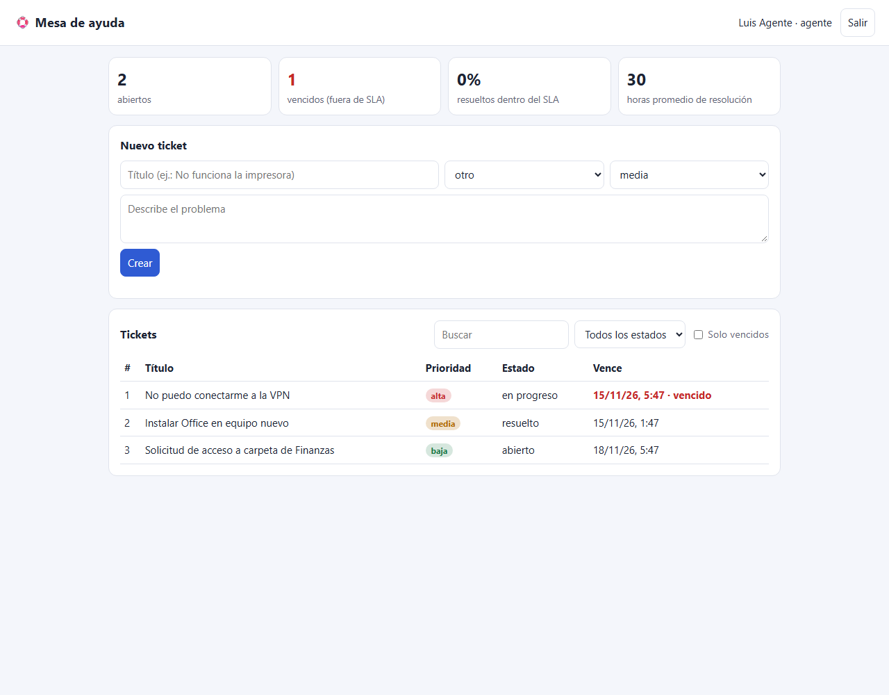

# Help Desk

> [Versión en español](README.md)



A support ticketing system: users report issues, the support team assigns, updates and answers them, and managers see **SLA** compliance metrics (maximum resolution time by priority).

## Features
- **Roles:** user (reports and follows own tickets), agent and admin (handle, assign, see metrics).
- **SLA by priority:** high 4 h, medium 24 h, low 72 h. Overdue tickets are flagged.
- **Controlled status workflow:** open → in progress → waiting → resolved → closed (and reopen). Invalid transitions return `409`.
- **Comments and internal notes** hidden from the requester.
- **Audit history:** who changed what and when.
- **Metrics:** open tickets by priority, overdue count, % resolved within SLA, average resolution hours.
- **Security:** `scrypt` password hashing with salt, expiring session tokens, input validation, no internal details leaked in errors.

## Stack
Node.js 24+ with TypeScript (native type stripping), Express 5, SQLite (`node:sqlite`, no native dependencies), plain HTML/CSS/JS front end, tests with `node:test`.

## Run it
```bash
npm install
npm start          # http://localhost:3000 (creates mesa.db with demo data)
npm test           # 18 tests: business rules and end-to-end API
```
Demo accounts: `admin@demo.local / demo-admin-123`, `agente@demo.local / demo-agente-123`, `usuaria@demo.local / demo-usuaria-123`.

## Design notes
- Business rules live in `src/tickets.ts`, separate from HTTP, so they are tested without a server.
- The app receives its database as a parameter; tests use an in-memory database.
- The code and UI are in Spanish; the API is documented in the Spanish README.

MIT License.
